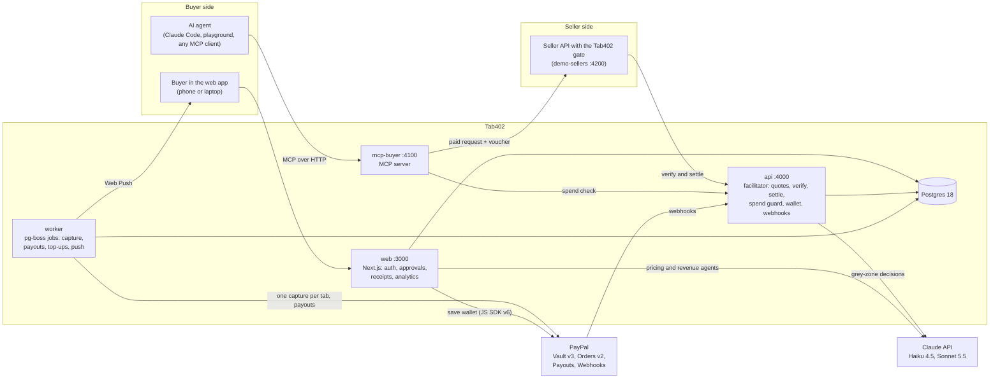
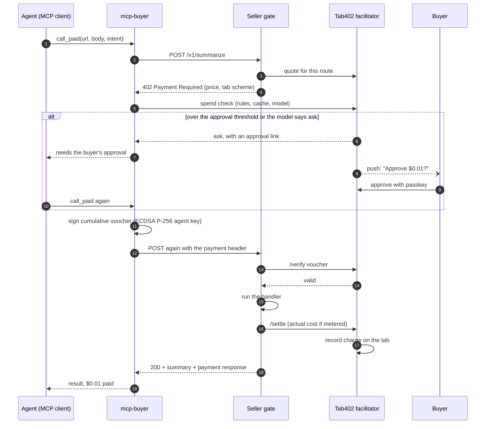
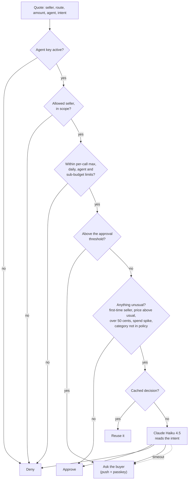
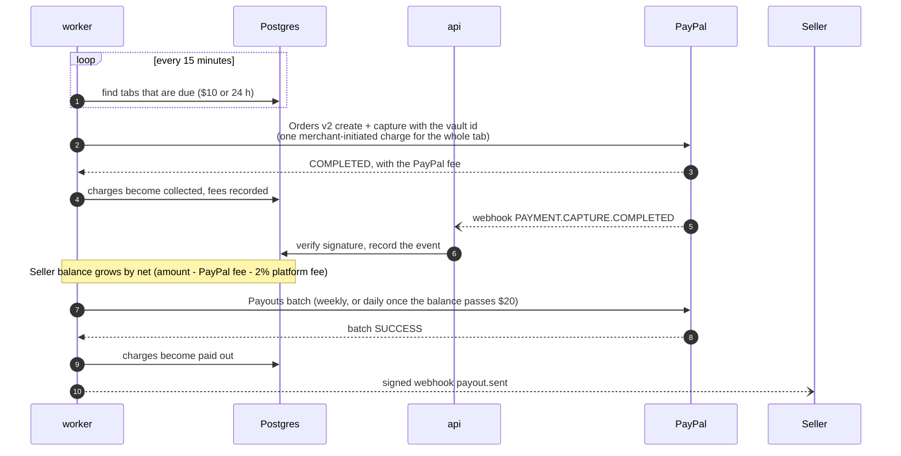
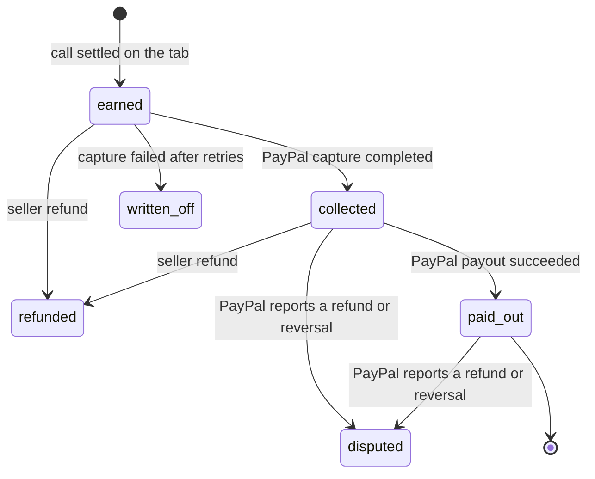
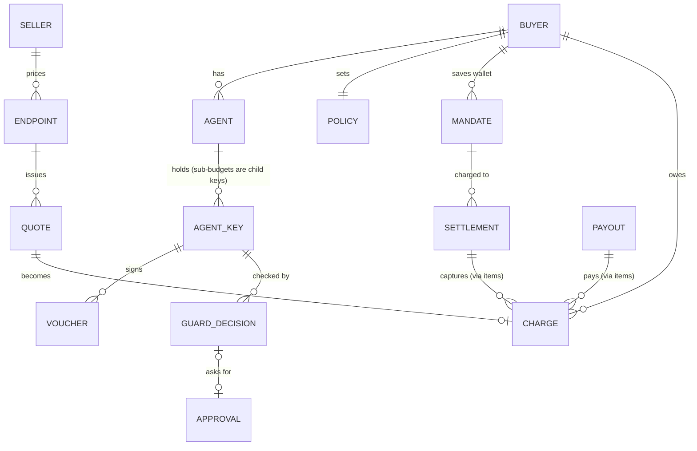
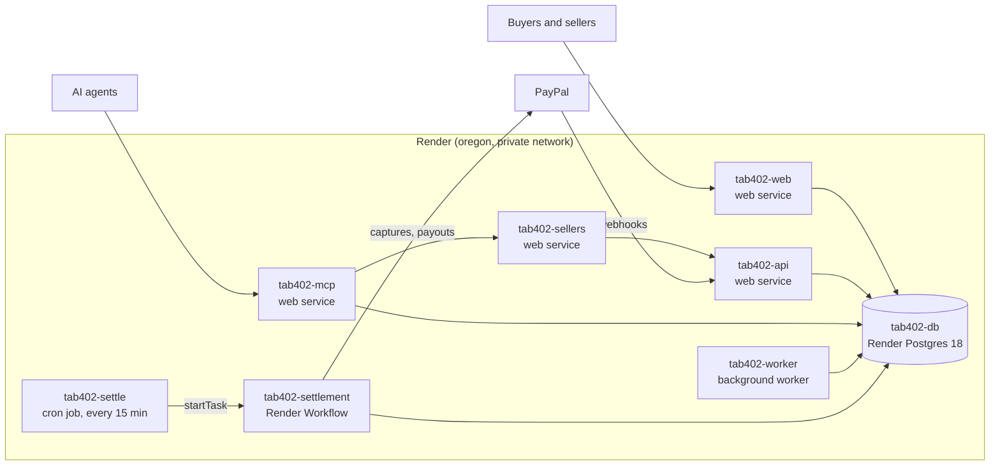
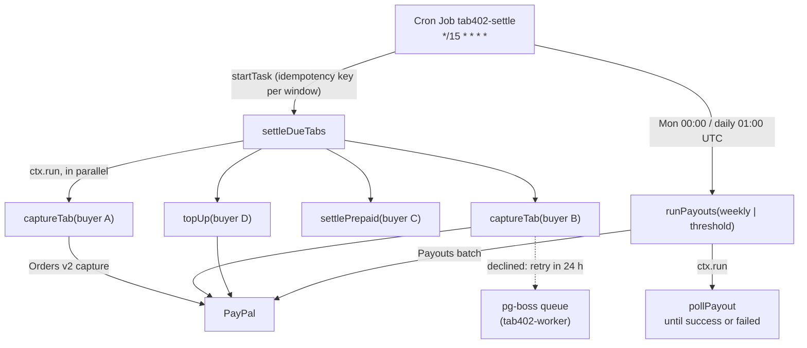

# Tab402

Tab402 lets AI agents pay for APIs by the cent. Each request goes through an x402-style `402 Payment Required` handshake, the agent signs a cumulative voucher on a running tab, and the tab settles through PayPal in one charge. Sellers get paid out with PayPal Payouts.

Built for the PayPal developer hackathon with PayPal Vault, Orders v2 (merchant-initiated), Payouts, Webhooks and the JS SDK v6 wallet-save flow.

| | |
|---|---|
| Try it | [Judge guide: set up and walkthrough](demo/README.md) (about 10 minutes) |
| Hosted demo | Not deployed yet. Deploy your own: [render.yaml](render.yaml) |
| Demo video | Link on the submission form |
| License | [MIT](LICENSE) |

## Contents

- [Why a tab](#why-a-tab)
- [Features](#features)
- [How it works](#how-it-works)
  - [System overview](#system-overview)
  - [Paying for one call](#paying-for-one-call)
  - [The spend guard](#the-spend-guard)
  - [Settlement and payouts](#settlement-and-payouts)
  - [Money states](#money-states)
  - [Data model](#data-model)
- [Tools and how they are used](#tools-and-how-they-are-used)
- [Deploy on Render](#deploy-on-render)
  - [Settlement on Render Workflows](#settlement-on-render-workflows)
- [Run it locally](#run-it-locally)
- [Use it from an agent](#use-it-from-an-agent)
- [Commands and tests](#commands-and-tests)
- [Project layout](#project-layout)
- [License](#license)

## Why a tab

A card or wallet charge costs about $0.49 plus 3.49%. On a one-cent API call that fee is fifty times the price. Tab402 records each call as a charge on the buyer's tab and only touches PayPal when the tab is due: at $10, or after 24 hours. A thousand one-cent calls become one PayPal capture instead of a thousand.

## Features

For buyers and their agents:

- An MCP server with seven tools (`search_services`, `call_paid`, `get_budget`, `get_tab`, `list_receipts`, `create_sub_budget`, `request_approval`). Agents connect with an API key or sign in through OAuth 2.1.
- An agent playground in the web app that drives the same MCP server from buttons.
- A spending policy with daily budgets, per-agent budgets, a per-call maximum, allow and block lists, and an approval threshold.
- Sub-budgets: an agent can give a task its own capped, expiring key.
- A spend guard that runs fixed rules first and sends unusual purchases to Claude Haiku 4.5.
- Approvals by push notification, confirmed with a passkey.
- Live receipts that record what each purchase was for, with CSV export.
- A PayPal wallet saved once with Vault, prepaid or post-paid.

For sellers:

- A Hono gate (`@tab402/sdk-server`) that answers 402, verifies vouchers and records the charge only when the handler succeeds.
- Fixed and metered prices. A metered call is charged its real cost, capped at the authorized amount.
- Pricing from an OpenAPI spec: Claude Sonnet 5.5 proposes a price per route and the seller confirms.
- A public directory and a `/.well-known/x402` manifest so agents can find the routes.
- Payouts through PayPal Payouts, signed merchant webhooks, and a payouts CSV.
- AG Studio dashboards with filters, cross-filtering and a revenue agent you can ask questions.

## How it works

### System overview



### Paying for one call

The seller's gate asks for payment, the agent pays with a voucher on its tab, and the facilitator records the charge only after the seller's handler succeeds.



### The spend guard

Every purchase is checked against the buyer's policy before the agent signs. Fixed rules decide most cases in a few milliseconds. Only the unusual ones reach the model, and its decisions are cached for 24 hours.



### Settlement and payouts



A prepaid buyer tops up the balance through the same vaulted wallet, and each call draws it down. A post-paid buyer gets a credit limit ($10 to start, $25 after three successful captures).

### Money states

Each charge moves through these states. Receipts and both dashboards use them.



### Data model

The main tables, simplified.



## Tools and how they are used

| Tool | Where | What it does in Tab402 |
|---|---|---|
| PayPal Vault v3 and JS SDK v6 | Web app wallet page, `packages/paypal` | Saves the buyer's PayPal wallet once, without a purchase, so later charges need no popup |
| PayPal Orders v2 | Worker | One merchant-initiated capture per due tab, using the vault id. Also prepaid top-ups |
| PayPal Payouts | Worker | Pays each seller's net balance in batches |
| PayPal Webhooks | API | Verifies and records capture, refund and payout events |
| Claude Haiku 4.5 | `packages/guard` | Spend guard for grey-zone purchases. Reads the agent's stated intent and approves, denies or asks a human. Times out to "ask" |
| Claude Sonnet 5.5 | `packages/agents` | Onboarding agent that prices routes from an OpenAPI spec, and the revenue agent behind Ask AI in seller analytics |
| Claude Opus 5.5 | `apps/demo-sellers` | The demo seller's summarize and chat endpoints when `DEMO_LLM=anthropic` |
| Model Context Protocol | `apps/mcp-buyer` | Remote MCP server (Streamable HTTP) with OAuth 2.1 discovery, dynamic client registration and PKCE |
| AG Studio (AG Grid and AG Charts) | `apps/web` analytics | Buyer and seller dashboards with filters, cross-filtering, pivots, and an AI panel wired to Tab402's data tools |
| Render | `render.yaml`, `apps/workflows` | Hosts the whole stack from one Blueprint. Tab settlement and seller payouts run as Render Workflows, started by a Render Cron Job |
| Postman | `docs/postman/` | Collection and local environment for the facilitator API, generated by `scripts/postman/build.ts` |
| Better Auth | `packages/auth` | Email sign-in, passkeys, and the OAuth provider for MCP clients |

Without an `ANTHROPIC_API_KEY`, each Claude feature falls back to a stand-in that labels its answers as mock output.

## Deploy on Render

[](https://render.com/deploy?repo=https://github.com/0xhaz/Tab402)

[render.yaml](render.yaml) is a Blueprint for everything: four web services, the background worker, the settlement workflow, a cron job and Postgres 18. In the Render dashboard choose **New, Blueprint**, pick this repo, and fill in the values Render asks for (PayPal sandbox app, Anthropic key, demo API keys, VAPID keys, and a Render API key for the cron job). `TAB402_MASTER_KEY` and `BETTER_AUTH_SECRET` are generated. Migrations and the seed run before each API deploy.



After the first deploy:

1. Check that each service got its plain name (`tab402-web.onrender.com` and so on). If Render added a suffix, update the `tab402-urls` environment group and redeploy.
2. In the PayPal sandbox app, add a webhook for `https://tab402-api.onrender.com/webhooks/paypal` and put its id in `PAYPAL_WEBHOOK_ID`.
3. Sign up on the web app before sharing it; passkeys are bound to that domain.

### Settlement on Render Workflows

On Render, the worker leaves settlement to a workflow (`SETTLEMENT_RUNNER=render`). Every 15 minutes the cron job starts `settleDueTabs`. It looks up what is due and runs each item as its own task run, in parallel, so a slow PayPal call for one buyer doesn't hold up the others. Render retries a failed capture three times with backoff (30 s, 1 min, 2 min). The handlers are the worker's own and idempotent: a retry resumes the same PayPal order instead of charging again. If a child still fails, the root run fails and names it in the dashboard.



| Task | Does | Retries |
|---|---|---|
| `settleDueTabs` | Finds due tabs, prepaid charges and top-ups, runs one child each | none (children retry) |
| `captureTab` | One merchant-initiated PayPal capture for a buyer's whole tab | 3, from 30 s |
| `settlePrepaid` | Moves prepaid charges to collected | 3, from 30 s |
| `topUp` | Tops up a prepaid balance from the vaulted wallet | 3, from 30 s |
| `runPayouts` | Opens and submits the day's payout batch | 5, from 1 min |
| `pollPayout` | Polls the batch every minute until it settles | 3, from 30 s |

To run a task by hand: `pnpm --filter @tab402/workflows trigger` (needs `RENDER_API_KEY`), or `trigger payouts weekly`. Locally, `pnpm --filter @tab402/workflows dev` runs the tasks under the Render CLI's local task server. Without Render, the worker settles with pg-boss exactly as before.

## Run it locally

The quickest path is the [judge guide](demo/README.md):

```sh
./demo/setup.sh   # checks tools, writes .env, installs, starts Postgres, migrates, seeds, builds
./demo/start.sh   # web :3000 · api :4000 · mcp-buyer :4100 · demo-sellers :4200 · worker
```

The same steps by hand. You need Node 24.21.0 (`nvm use`), pnpm 12.9.1 (`corepack enable`) and Docker.

```sh
cp .env.example .env            # set TAB402_MASTER_KEY, BETTER_AUTH_SECRET, demo API keys, PayPal sandbox app
pnpm install
pnpm db:up                      # Postgres 18 on localhost:5433
pnpm db:migrate && pnpm db:seed
pnpm turbo run dev --filter='!@tab402/web'                            # terminal A: api, mcp-buyer, demo-sellers, worker
pnpm --filter @tab402/web build && pnpm --filter @tab402/web start    # terminal B: web app
```

The web app runs as a production build so its service worker and push notifications work. Other useful URLs: the API reference at http://localhost:4000/docs (OpenAPI at `/openapi.json`) and the public directory at http://localhost:3000/directory.

On a phone, the web app installs as a PWA. Push on iPhone needs **Share, Add to Home Screen** first (iOS 16.4+). A real phone also needs HTTPS: use a tunnel and set `BETTER_AUTH_URL` and `WEB_URL` to it, since passkeys are bound to the domain.

## Use it from an agent

Claude Code with an API key:

```sh
claude mcp add --transport http tab402 http://localhost:4100/mcp \
  --header "Authorization: Bearer $DEMO_BUYER_API_KEY" --header "X-Tab402-Agent: Claude Code"
```

Leave out the headers to sign in through the browser instead. Then ask Claude to find and use a paid API, for example *"summarize this note with a paid summarizer"*. Without Claude, `npx tsx --env-file=.env scripts/demo/mcp-smoke.ts` runs the same tools, and `scripts/demo/pay.ts` pays the demo sellers over plain HTTP with `@tab402/sdk-client`.

A seller adds the gate to a Hono app:

```ts
import { tab402Gate } from "@tab402/sdk-server";

app.use("*", tab402Gate({
  facilitatorUrl: process.env.TAB402_API_URL,
  apiKey: process.env.TAB402_SELLER_KEY,
  baseUrl: "https://api.example.com",
  routes: {
    "POST /v1/summarize": { price: 10_000 },                     // micro-USD: $0.01
    "POST /v1/chat": { pricing: "metered", price: 50_000 },      // up to $0.05, charged at cost
  },
}));
```

## Commands and tests

| Command | Does |
|---|---|
| `pnpm test` | Unit, Postgres integration (`tab402_test`) and end-to-end tests (`tab402_e2e`) |
| `pnpm --filter @tab402/browser-tests test:browser` | Playwright against a production build of the web app (build it first). Uses its own database (`tab402_browser`) and ports 3300 and 4300, so the dev servers can stay up |
| `pnpm typecheck` | TypeScript 7 across all packages |
| `pnpm lint` / `pnpm format` | Biome check / fix |
| `pnpm db:generate` | New Drizzle migration after editing `packages/db/src/schema.ts` |
| `pnpm db:down` | Stop Postgres (data stays in the `tab402-pg` volume) |
| `npx tsx --env-file=.env scripts/demo/settle-sandbox.ts [calls]` | Real PayPal sandbox run: paid calls, one capture, one payout |
| `npx tsx --env-file=.env scripts/agents/try-onboarding.ts [spec]` | Run the onboarding agent on a spec |
| `npx tsx --env-file=.env scripts/agents/try-revenue.ts ["question"]` | Run the revenue agent on a seeded scenario |
| `npx tsx scripts/postman/build.ts` | Regenerate the Postman collection in `docs/postman/` |

## Project layout

```
apps/
  api            facilitator (/quotes /verify /settle /supported), sellers, buyers, wallet, refunds, events, PayPal webhooks
  worker         pg-boss jobs: settlement scan, capture and retry, top-ups, payouts, merchant webhooks, reconciliation
  mcp-buyer      remote MCP server for agents: search, pay, budgets, receipts, approvals
  demo-sellers   example paid API: /v1/summarize (fixed), /v1/chat (metered), /openapi.json, /.well-known/x402
  web            Next.js 16: auth and passkeys, OAuth for MCP, wallet, policy, approvals, receipts, playground, AG Studio
  workflows      Render Workflows: settlement and payout tasks, and the cron trigger
packages/
  core           x402 tab scheme, vouchers, money
  db             Drizzle schema, migrations, seed, envelope encryption for vault tokens
  sdk-server     Hono gate for sellers
  sdk-client     paying fetch and agent key registration
  paypal         Vault, Orders, Payouts, webhook verification
  ledger         settlement rules, fees, refunds, payouts
  guard          spend guard: rules, Claude grey zone, decision cache, approvals
  agents         onboarding agent and revenue agent tools
  auth           Better Auth setup
  notify         Web Push delivery
  config         shared env schemas
demo/            judge setup, start and walkthrough
scripts/         PayPal sandbox checks, demo clients, agent trials, Postman build, video script
tests/
  e2e            whole-system tests
  browser        Playwright tests
```

## License

[MIT](LICENSE)
